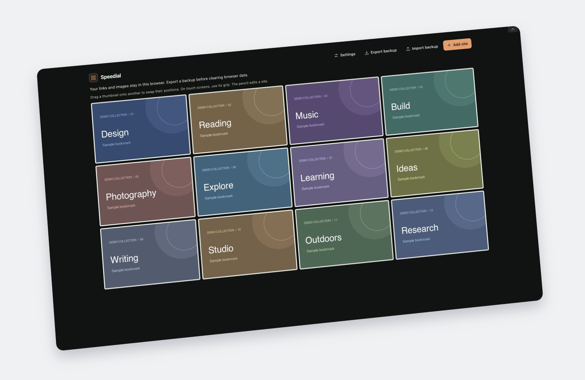
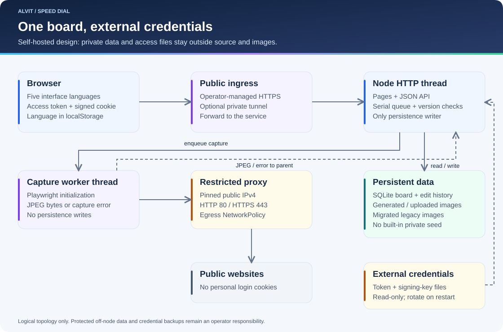

# Alvit Speed Dial

[English](README.md) · [Русский](README.ru.md) · [Deutsch](README.de.md) · [Français](README.fr.md) · [Español](README.es.md)



Browser-local edition · synthetic bookmarks and demo cover artwork · [Flat screenshot](docs/images/speedial-local.jpg) · [Capture and rendering](docs/images/README.md)

Two editions remain available: **Speedial** stores a personal board in each browser; **self-hosted Speed Dial** stores a shared board on your server and generates screenshots. Choose the data model before following a setup or backup guide.

[Open the local app](https://speedial.alvit.here.now/) · [Browser backups](docs/browser-backups.md) · [Node.js](#local-development) · [Docker](#docker) · [k3s / Kubernetes](#k3s--kubernetes) · [CI runners](docs/CI.md) · [Organization profile example](docs/organization-profile.md)

## Public browser-local edition: Speedial

[Open Speedial](https://speedial.alvit.here.now/) — the public, browser-local app. This is the primary address to bookmark and use for your board. [Storage, privacy and transfer guide](docs/local-speedial.md).

Each visitor starts with an empty board. Links, settings and image bytes stay in that browser profile; visiting the same URL or copying a local board ID on another computer does not reveal them. There is no shared board API, cloud synchronization or automatic website capture. Five languages and the existing tile controls are retained.

Use **Export backup** and **Import backup** to move the complete board, including images and language, deliberately. Import replaces the destination board after a preview and confirmation. Different domains, browsers and profiles have separate storage, even when they display identical app code. Keep the unencrypted JSON backup private; browser cleanup can erase the local board.

Build with `npm run build:local`; verify with `npm run test:local`. Publish only the allowlisted `dist/local` output. The self-hosted edition described below remains separate.

### Back up or move your browser board

With Node.js 24+ in this checkout:

```sh
npm run backup:browser -- --browser chrome
npm run restore:browser -- backups/YOUR-BACKUP.json --browser firefox
```

These interactive helpers guide export/import in the selected browser and archive complete backups in the Git-ignored `backups/` directory. Restore first preserves the destination board, then compares a fresh export with the source. Chrome, Firefox and other installed macOS browsers can be opened by name; use `--no-open` for an already-open browser or on Windows/Linux. They do not read internal profile databases or synchronize browsers. See the [full procedure and privacy limits](docs/browser-backups.md).

## Self-hosted edition

A self-hosted shared bookmark board with compact screenshot tiles, direct editing, pairwise drag-and-drop, and persistent settings. The interface supports English, Russian, German, French, and Spanish.

The server reads access credentials from external files and keeps board data outside the application image. This public repository contains reusable application code and generic deployment examples. Private operational state and recovery records belong in the private operations repository; deploy a pinned revision of this source without copying its code into the operational repository.

[User guide](wiki/User-Guide.md) · [Architecture](wiki/Architecture.md) · [API](wiki/API.md) · [Cutover and rollback](deploy/README.md) · [Security](SECURITY.md)



## Features

- Compact tiles with no persistent captions; a collapsed header reveals controls with the upper-right arrow.
- Add, edit, delete, and export bookmarks. New URLs queue screenshots automatically; PNG, JPEG, WebP, and GIF uploads up to 5 MiB can replace them.
- Drag previews follow the pointer. Only source and destination tiles swap; every other position stays fixed. Touch grips and keyboard controls are supported.
- Choose 1–12 rows and columns. The default is 4 × 5; overflow is paginated without deleting or reordering bookmarks.
- Links open in the same window by default, with a new-window/tab option.
- Five UI languages, with English as the default. Language is local to the browser; grid dimensions and link behavior are shared board settings.
- Fresh databases start empty. Optional, operator-provided initial state stays outside the application source and image.

## Access model

Configure two external credential files before startup:

- `ACCESS_TOKEN_FILE`: trimmed URL-safe text with at least 32 characters. Use a cryptographically random token.
- `SESSION_KEY_FILE`: at least 32 raw bytes used for signing sessions.

The entry URL has the form `https://bookmarks.example.test/?access=<token>`. `<token>` is a placeholder, never a value to deploy. The correct query is required for every page navigation, including browsers that already have a valid cookie. A bare or incorrect entry returns 404. The signed session authorizes both viewing and editing; there is no separate editor password or per-user account.

Changing the access token, signing key, or optional `AUTH_EPOCH` and restarting invalidates existing sessions. Keep the credentials, complete entry URL, runtime data, and private bookmark images outside Git. Read the [security model](SECURITY.md) and [configuration](wiki/Configuration.md).

## Local development

Requires Node.js 24+ and an installed Chromium executable. `playwright-core` does not download Chromium automatically.

Create development-only files without printing their contents:

```sh
npm ci
umask 077
mkdir -p secrets
node --input-type=module <<'JS'
import { randomBytes } from 'node:crypto';
import { writeFileSync } from 'node:fs';
writeFileSync('secrets/access-token', randomBytes(32).toString('base64url'), { mode: 0o600, flag: 'wx' });
writeFileSync('secrets/session-key', randomBytes(48), { mode: 0o600, flag: 'wx' });
JS
ACCESS_TOKEN_FILE="$PWD/secrets/access-token" \
SESSION_KEY_FILE="$PWD/secrets/session-key" \
CHROMIUM_PATH=/usr/bin/chromium npm start
```

Read the development token privately and enter it in the local URL `http://localhost:3000/?access=<token>`. On other systems, set the actual Chromium executable path. For HTTPS deployment, configure `PUBLIC_ORIGIN` to the exact external origin without a trailing slash.

```sh
npm run check
CHROMIUM_PATH=/path/to/chromium npm run test:browser
```

Tests use isolated data and synthetic bookmarks. They do not certify live routing, credential rotation, or production migration.

## Storage and deployment

`DATA_DIR` contains SQLite, generated/uploaded images, and optional migrated legacy images under `legacy-images/`. Credential files are mounted separately. `INITIAL_STATE_FILE`, when supplied for a fresh database, points to an external initial-state JSON file. Existing databases are not reseeded on upgrade.

Deploy one process per SQLite volume. The reference k3s model uses one replica and `Recreate`; adapt placement, volume provisioning, ingress, and image references to your environment. Do not scale multiple writers onto the same database.

Back up consistent application data plus the external credentials through a private backup system. The UI JSON export does not embed image bytes and has no built-in import endpoint. See [operations](wiki/Operations.md) and the detailed [cutover and recovery guide](deploy/README.md).

### Docker

The checked-in [Dockerfile](Dockerfile) still runs the self-hosted server with Chromium. For a fresh local instance, create the development credentials above, then run these commands from a POSIX shell with Docker available:

```sh
docker build --tag speeddial:local .
umask 077
mkdir -p data/docker
docker run --rm --name speeddial-local \
  --user "$(id -u):$(id -g)" \
  --publish 127.0.0.1:3000:3000 \
  --env HOME=/tmp \
  --env ACCESS_TOKEN_FILE=/run/secrets/speeddial/access-token \
  --env SESSION_KEY_FILE=/run/secrets/speeddial/session-key \
  --mount "type=bind,src=$PWD/secrets,dst=/run/secrets/speeddial,readonly" \
  --mount "type=bind,src=$PWD/data/docker,dst=/data" \
  speeddial:local
```

Run as your non-root host user so the container can read the owner-only development credentials and write the local data directory. Open `http://localhost:3000/?access=<token>` with your private token. Removing the container preserves `data/docker`; never point a second instance at that directory. Both `data/` and `secrets/` are ignored by Git and excluded from image build input. This loopback-only example is for local development; an HTTPS deployment also needs the exact `PUBLIC_ORIGIN`, controlled ingress, protected secrets and a verified data backup.

### k3s / Kubernetes

The [Kustomize base](deploy/kustomization.yaml) remains available with one application replica, `Recreate` updates, persistent storage, health probes, a read-only Secret mount and a network policy. Inspect the generic manifest without changing a cluster:

```sh
kubectl kustomize deploy
```

Prepare your own overlay for the verified image digest, external origin, architecture and storage placement, Secret permissions and ingress/tunnel selectors. The checked-in image reference is a placeholder. Follow the [cutover and rollback runbook](deploy/README.md), [configuration](wiki/Configuration.md) and [operations](wiki/Operations.md) before applying it. Manage DNS/tunnels and repository settings in the appropriate private infrastructure repository and state. A source push or local-app publication does not deploy or migrate the server.

## Documentation and source safety

The canonical documentation is in [wiki/](wiki/Home.md). It covers use, API, architecture, localization, operations, troubleshooting, and [source and deployment process](wiki/Process-and-Results.md). See [Contributing](CONTRIBUTING.md), [Security](SECURITY.md), [Changelog](CHANGELOG.md), and [documentation maintenance](docs/README.md).

The [organization profile guide](docs/organization-profile.md) includes a reusable README example for the organization itself. It describes the public app without exposing personal board data or private deployment details.

This public repository starts with a clean source history and synthetic fixtures. The separate private operations repository retains historical private material and deployment recovery configuration; its history must not be copied here. Browser backups, server data and credentials remain outside Git. The source is publicly readable, but remains `UNLICENSED`; public visibility does not grant an open-source redistribution license.
