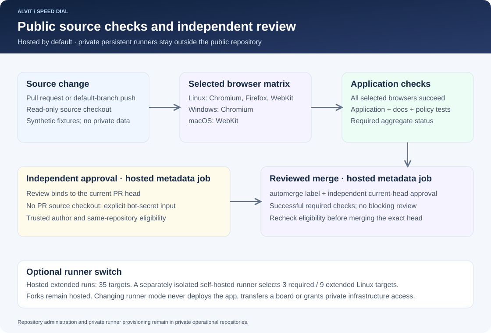

# CI runners and reviewed merging

The public repository validates both browser-local Speedial and the self-hosted server. It uses immutable revisions of the public [venus-os-ci-toolkit](https://github.com/victron-venus/venus-os-ci-toolkit) workflows. Repository administration, Terraform state and private runner provisioning belong in `speeddial-private`, not in this source checkout.



## Runner switch

GitHub-hosted execution is the default. Configure Actions variables only when a separately provisioned runner is ready:

- `CI_RUNNER_MODE`: unset or `github` selects GitHub-hosted runners; `self-hosted` enables a dedicated runner; `k3s` is a compatible alias.
- `CI_RUNNER_LABELS`: a JSON array selecting the separately qualified Linux runner. Labels select machines; they do not authorize access.

The private operational repository's persistent runner is not registered to this public repository. Do not reuse a credential-bearing private runner for public source jobs. Any future self-hosted runner must be isolated from private infrastructure, secrets and later privileged jobs. Qualify checkout, Node, npm, Python, browser OS libraries, artifact access and cleanup before switching.

In self-hosted mode, only same-repository pull requests and trusted default-branch push, schedule and dispatch events select that runner. Fork pull requests and untrusted contexts remain hosted. Missing labels fail admission rather than silently selecting an arbitrary machine. Metadata approval and merge jobs stay on GitHub-hosted runners for this public repository.

Changing a variable does not relocate queued jobs. Start a new run and verify its actual runner identity. Set `CI_RUNNER_MODE=github` to return to hosted execution. This switch does not deploy the application or copy browser data.

## Browser coverage

Hosted mode has five required targets: Chromium, Firefox and WebKit on Linux, Chromium on Windows, and WebKit on macOS. Scheduled or extended manual runs retain the full 35-target inventory, including older pinned Playwright versions and supported Chrome/Edge channels. Self-hosted mode uses three required Linux engines or nine extended Linux targets; it does not certify omitted native platforms.

Each target runs the self-hosted frontend suite and the browser-local privacy/backup suite using synthetic data. The [browser guide](browser-compatibility.md) explains the exact inventory, locked toolchains and runtime checks. The shared workflow installs OS dependencies on hosted runners and expects them to be preinstalled on self-hosted runners. Browser archives are isolated under `RUNNER_TEMP`.

## Required checks and review

The required aggregate status is **`Application checks`**. It waits for the complete selected browser workflow and accepts only a successful browser result. Failed, cancelled or skipped browser targets cannot produce a successful aggregate. It also runs the application, documentation and CI policy checks. Private Terraform and runner provisioning checks do not run in this public source repository.

Credential-bearing approval and merge workflows operate on GitHub metadata and never check out PR code. `BOT_PAT` authenticates the independent reviewer/merger `californiantiramisu`; `APPROVAL_PAT` supports independent review of bot-authored PRs where configured. A reviewer cannot approve its own change. Tokens belong in protected Actions secrets, never source, logs or Terraform state.

A ready same-repository PR targeting the default branch must have a trusted author, the `automerge` label, successful required checks and an independent approval of its current head. Pending or failed checks and outstanding changes requests block the reviewed merge. A new push requires fresh checks and current-head approval. Keep the branch updated with the default branch.

The shared workflow evaluates eligible PRs once per invocation. PR events, CI/review completion, statuses, manual dispatch and a recovery schedule trigger reevaluation. Removing `automerge` or converting to draft withdraws eligibility. Reviewed merge policy complements any server-enforced repository protection; it does not replace it.

## Local policy validation

[The CI policy checker](../scripts/check-ci-policy.py) validates pinned workflow references, runner boundaries, required checks and the metadata-only credential contracts. [Regression tests](../test/test_ci_policy.py) modify representative workflow inputs to verify that unsafe changes fail.

```sh
python3 scripts/check-ci-policy.py
python3 -m unittest discover -s test -p 'test_ci_policy.py'
actionlint .github/workflows/*.yml
```

Policy changes require corresponding implementation and negative-test updates. A passing source check is not proof of a deployment, a private-data restore or runner isolation.
