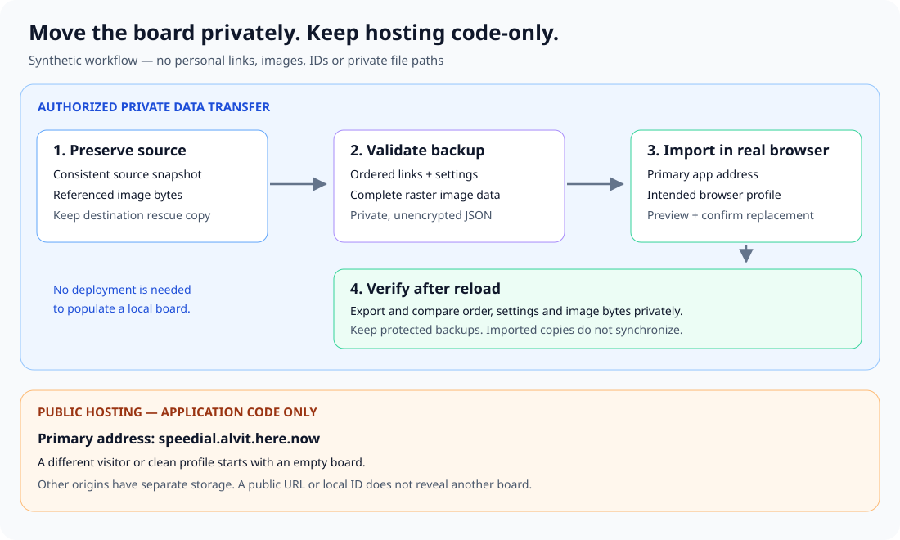

# Move an existing board into the public app

For a board already stored in Chrome or another browser, use the [local backup and restore scripts](browser-backups.md). They save private, Git-ignored copies and guide the destination rescue and verification steps below.

This transfer does not replace or disable the self-hosted application. [Node.js, Docker and k3s deployment options](../README.md#storage-and-deployment) remain available. A browser backup and a [server recovery set](../wiki/Operations.md#backup-and-restore) are separate artifacts; neither is a drop-in restore format for the other.

Use [the primary Speed Dial address](https://speeddial.alvit.here.now/) for the destination board. This is a private data transfer into a particular browser profile, separate from publishing app code. A successful import in a test browser does not populate the user's real browser.

## Preserve the source and destination

Obtain an authorized, consistent source export or read-only database snapshot and the actual bytes of every referenced image. Check that concurrent source edits or screenshot updates have not changed the snapshot while collecting its images. The older server JSON export contains image paths rather than image bytes; copying that JSON alone cannot restore the previews.

In the intended real browser profile, open the primary address and export its current local board before replacing anything. Even an empty destination should be checked explicitly. A different domain, hosting alias, browser profile or device has separate storage. Keep source snapshots and destination rescue copies outside Git and published assets, with access restricted to their owner.

## Prepare and validate the complete private backup

The destination accepts the versioned `speedial-local-backup` JSON format implemented in [storage.js](../local/storage.js). A complete backup contains the ordered tile metadata, grid and link-opening settings, image bytes encoded in the image records, and an optional supported interface language. The validated local app export is the reference format. This runbook does not assume a general server-to-local conversion command exists.

For a transfer from the older server, an authorized private conversion must collect image bytes and build that complete format. Preserve the source's link order, titles, URLs and settings. Use the local validator to reject missing images, invalid references, unsupported URLs, corrupt raster data and oversized input before import. Supported uploads are PNG, JPEG, WebP and GIF, with a 5 MiB per-image limit, 60 MiB total image budget and 100 MiB backup-file limit. Verify the current limits in the implementation before preparing a large transfer.

Do not include server credentials, cookies, signing keys, internal configuration or unused image history in the local backup. Do not publish the backup, put it in an application seed, upload it to a public file-sharing URL, or paste its contents into documentation. The local importer reads the selected file without sending it to the host.

## Import into the actual browser

1. Return to the intended browser profile at [speeddial.alvit.here.now](https://speeddial.alvit.here.now/).
2. Expand the upper-right controls and select **Import backup**.
3. Choose the privately prepared complete JSON file. Inspect the summary and any validation errors.
4. Confirm **Replace this board** only after preserving the destination copy. The replacement is transactional; a validation error, quota failure or revision conflict must not partially replace the current board.
5. Reload the page and verify that the board is still present. A new site publication is unnecessary: the data is in this browser's IndexedDB.

If another tab edits the destination during this process, review the updated board and repeat the confirmation deliberately. Do not bypass the revision check. If browser storage is blocked, enable it for the site and follow the recovery message before importing again.

## Verify the result without exposing it

Export the destination board after reload and privately compare it with the source transfer. Check ordered URLs and titles, grid dimensions, link-opening behavior, the intended language, and the bytes of every image. Image hashes can establish that preview bytes survived the round trip, but the resulting inventory remains private. Local tile and image IDs are regenerated on import and are not expected to match source IDs.

Use a separate, clean browser profile to verify that visiting the same public address starts empty. Do not import the private backup into that profile. This separation check complements the deterministic acceptance tests; it does not require publishing personal content or taking screenshots of private links.

Retain protected source and destination backups until the real-browser round trip has been verified. Browser persistence permission can reduce eviction risk but does not replace a backup. Future edits on the source or another imported copy are independent: this procedure does not enable cloud synchronization or automatic screenshots.

Record completion only after the real destination has passed the reload and export comparison. Keep evidence, private paths and content hashes outside this repository. Public documentation records the procedure and application behavior, not a visitor's private board contents.
