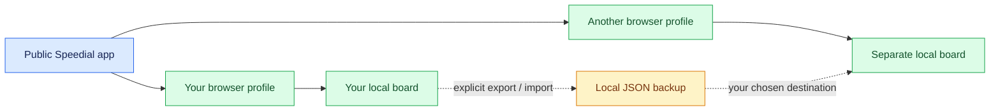

# Alvit · 4alvit

Tools for everyday workflows, with clear choices about where data lives.

## Speedial

**A visual start page for your own links.** [Open Speedial](https://speedial.alvit.here.now/) and build a board with image tiles, a compact header and your preferred grid.

- Drag one tile onto another to swap their positions.
- Choose rows, columns and whether links open in the current or a new window.
- Use English, Russian, German, French or Spanish.
- Upload or paste tile images and export a complete backup for another browser.

### Public app, personal browser data

The public edition stores links, images and settings in the current browser profile. Each new profile starts with an empty board. The app does not upload the board or synchronize it between devices. Keep a backup before clearing browser data or changing profiles.

Backups include links, images and settings in plaintext. Anyone with access to a backup or the same unlocked browser profile can read that data. Automatic website screenshots are available in the separate server edition; in the public browser edition, you provide the tile images.

### Self-hosting remains a separate option

The self-hosted server edition supports Node.js, Docker and k3s deployment, with a server-side SQLite database and image storage. Its access controls, credentials and backups are managed by the operator. Running that edition does not connect it to a board in the public app automatically.

Explore the [public source, deployment examples and documentation](https://github.com/4alvit/speeddial). The source remains `UNLICENSED`. Personal boards, credentials and private recovery records are not included in the public repository.
