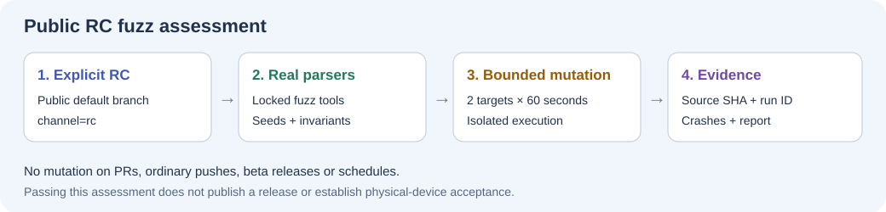

# RC fuzz testing

[](https://github.com/4alvit/speeddial/actions/workflows/fuzz-candidate.yml)



## Scope and purpose

**Portable backup JSON and PNG, GIF, JPEG and WebP dimension headers.** The targets invoke `local/storage.js`: `parseBackupDocument`, `fields`, `imageDimensions` and `base64Bytes` directly. They test production code rather than a copied parser or a random JSON-only loop.

The backup target checks schema rejection, duplicate IDs, forbidden prototype fields, credential-free HTTP(S) URLs and stable normalization. The image target checks bounded dimensions and byte-offset-independent parsing. It does not claim full raster decoding: the browser still decodes images during a real import.

The engine is **JavaScript / Jazzer.js**. Two targets each receive a 60-second mutation budget; input size is capped at 65536 bytes. Dependencies are pinned in the isolated fuzz lockfile. Fuzz tooling is not an application runtime dependency.

## When it runs

The shared `venus-os-ci-toolkit` workflow accepts only an explicit `channel=rc` dispatch from this public repository's default branch. It does not start timed mutation on pull requests, ordinary pushes, beta releases, schedules or private repositories. Ordinary tests replay fixed inputs without a timed campaign.

```sh
gh workflow run fuzz-candidate.yml --repo 4alvit/speeddial --ref main -f channel=rc
```

Use the exact source commit and run ID when reviewing the result. A green historical badge is not proof for a later untested commit. The shared workflow and runner are pinned together to a reviewed full commit SHA.

Product release, deployment and any hardware acceptance remain separate decisions. This assessment does not create a GitHub release or a version tag.

## Local deterministic verification

Run the repository's documented dependency setup, then:

```sh
npm run fuzz:replay
```

The committed corpus includes valid formats, malformed boundaries and explicit security rejections. To add a regression, minimize the failure, remove any sensitive data, save a synthetic case in `fuzz/corpus/`, and rerun the ordinary tests before another RC assessment.

## Results and limitations

The workflow retains a machine-readable report tied to source revision and workflow run, actual engine execution counts, diagnostics and generated crash inputs. Positive execution counts and successful invariant checks are required; an empty or skipped target is not a passing campaign. Download the report from the matching Actions run. Keep the run URL with any release review before artifact retention expires.

A failure is actionable: reproduce it with the same locked toolchain, correct the production behavior or an incorrect invariant, retain the minimized regression, and rerun the assessment. Do not weaken the assertions or relabel a crash to make the workflow green.

This is bounded repository CI fuzzing, not registration in Google's OSS-Fuzz service, a proof of absence of bugs, or a physical-device test. See the [shared workflow documentation](https://github.com/victron-venus/venus-os-ci-toolkit/blob/main/docs/rc-fuzzing.md) for isolation, budgets and evidence rules.
