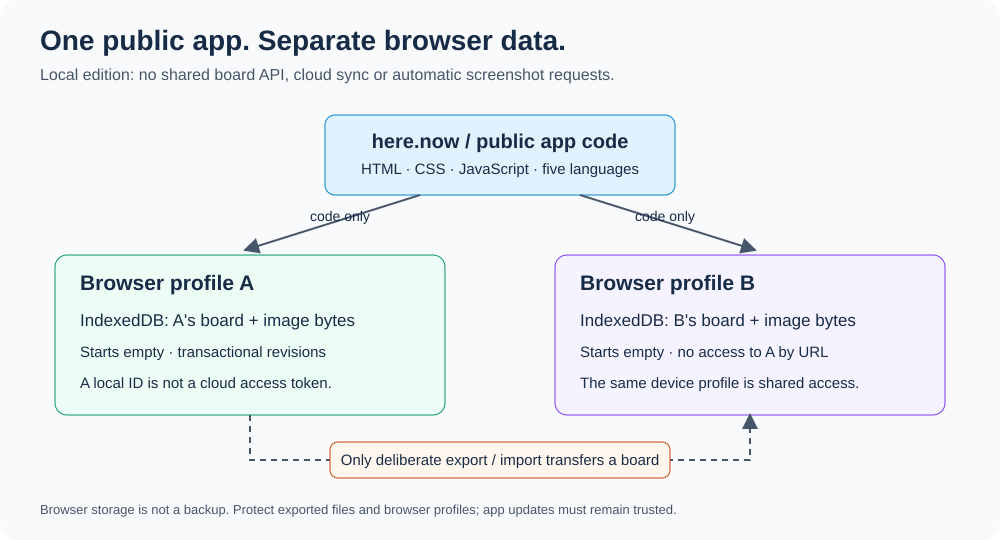

# Speedial: the public, browser-local edition

[Open Speedial at its primary address](https://speedial.alvit.here.now/). The app is publicly available in the Alvit workspace; no access token or editor password is required. Bookmark this address and keep using it for your board.

Speedial is a separate static edition of this project. Its public code starts each new browser profile with an empty board, while links, settings and image bytes stay in that profile’s IndexedDB. It does not use the server edition’s API, database, initial state, credentials or screenshot worker. [Node.js, Docker and k3s remain supported deployment paths](../README.md#storage-and-deployment) for the server edition.



## What is private, and what is not

- A first visit starts empty. There are no personal bookmarks or screenshots in the public bundle.
- Adding, editing and rearranging bookmarks, importing and exporting backups, and uploading images do not send the board to a server. The app has no fetch, WebSocket, analytics SDK, image proxy or cloud synchronization client. Its Content Security Policy sets `connect-src 'none'`.
- A local board ID is a label, not a password or cloud recovery key. Copying an ID or page URL into another browser does not load the first browser's data. People using the same browser profile share that profile's IndexedDB.
- Clicking a saved link deliberately navigates to that website. That website then receives a normal page request. App hosting still sees requests for public code and may keep hosting-layer logs; local storage is not anonymous network access.
- A malicious browser extension, access to the browser profile, XSS or a compromised future app update could read local data. The app does not claim encryption at rest, protection from the device owner, or an absolute secrecy guarantee.
- Exported backups contain private links and image bytes in readable form. Store and share them accordingly. The app does not upload backup files.

## Using the local edition

The upper-right arrow expands controls. Add and edit sites, drag one thumbnail onto another to swap exactly those two positions, or use a tile's keyboard controls. Settings offer 1–12 rows and columns, same-window links by default, and English, Russian, German, French or Spanish. Extra tiles are paginated.

Images can be selected from a local file or pasted into the site editor. The local edition does not automatically capture remote websites or load their favicons. A generated initial is shown until an image is supplied. Automatic capture would disclose the target URL to a separate renderer and is deliberately outside this edition.

Use **Export backup** to save a complete versioned JSON backup with links, image bytes, layout, link-opening settings and language. Use **Import backup** to validate a backup and review its summary before confirming replacement of the current local board. Export the destination board first if it must be retained. Failed validation, a quota error or a revision conflict leaves the existing board intact. The server application's JSON export only contains image paths and is not this complete backup format.

The app requests persistent browser storage only when the user selects that control in Settings. The browser may refuse. Clearing site data, deleting the browser profile, private-browsing cleanup and storage eviction can still lose data; persistence is not a backup. If browser storage becomes unavailable or is reset, the app shows a translated error and a **Reload page** action rather than silently switching to temporary memory.

## Move a board between browsers or addresses

The [local backup and restore scripts](browser-backups.md) automate export-file validation, protected local archiving, destination rescue copies and content comparison. Export and import confirmations remain in the intended browser profile.

```sh
npm run backup:browser -- --browser chrome
npm run restore:browser -- backups/YOUR-BACKUP.json --browser firefox
```

Run these from the checkout with Node.js 24+. Replace `YOUR-BACKUP.json` with the saved file. Copies stay in the ignored `backups/` directory and never enter the public build. Use `--no-open` for an already-open browser or on Windows/Linux. The [Russian guide](browser-backups.ru.md) describes the same workflow.

For an existing server board, follow the [private migration and real-browser verification runbook](browser-migration.md). It explains the source-image collection step that a server JSON export alone cannot perform.

An origin consists of the scheme, hostname and port. Different origins have separate IndexedDB storage, even if they serve identical app code. A hosting provider’s generated address is therefore not interchangeable with the primary address for an existing local board. Browser profiles and devices are separate as well; an app deployment does not copy data between them.

1. In the browser and address that currently hold the board, select **Export backup**. Keep the downloaded JSON file private: it includes the readable links and images.
2. Open [the primary Speedial address](https://speedial.alvit.here.now/) in the destination browser profile. A first visit is expected to be empty. Export any existing destination board before replacing it.
3. Select **Import backup**, choose the complete Speedial local JSON file, review the link/image summary and confirm replacement. The file is read in that browser; it is not uploaded to here.now.
4. Reload the destination and verify the intended order, images, grid, link target and language. Keep the source board and protected backup until this verification succeeds.

Import is a one-time copy, not synchronization. Later changes remain separate. Do not paste private JSON into source files, publish it as a hosting asset, or share the backup through a public URL. Migrating an older server board requires an explicitly authorized private conversion that collects its actual image bytes; a JSON file containing server image paths alone cannot restore those images. The conversion and real-browser import must be verified separately from public-app acceptance.

## Data and concurrency

The browser repository in [storage.js](../local/storage.js) owns IndexedDB transactions. Metadata and image-byte mutations commit together. Revisions are compared within the write transaction, so a stale tab cannot silently overwrite a newer board. Cross-tab notifications reload data; edits still use revision checks. Images are persisted as binary ArrayBuffers plus their MIME type and reconstructed as Blobs for display. This avoids WebKit failures when storing Blob/File objects directly. The database never persists temporary `blob:` image URLs.

Uploads are bounded raster images; remote image addresses, SVG, credential-bearing links, non-HTTP(S) links, unknown backup versions, unexpected keys and oversized input are rejected. Backup validation finishes before replacement begins. The exported snapshot includes the image bytes rather than paths into someone else's server.

See the implementation limits in [storage.js](../local/storage.js). Limits are safety budgets, not an estimate of available browser quota. Runtime quota failures are handled without claiming a successful save or silently switching to disposable in-memory storage.

## Build and verify

```sh
npm ci
npm run check
npm run build:local
CHROMIUM_PATH=/path/to/chromium npm run test:local
```

[build-local.mjs](../scripts/build-local.mjs) copies only the explicit frontend allowlist into `dist/local`. It refuses symlinked source files, unexpected large assets and networking APIs in the local JavaScript. It never traverses the repository, runtime data or Git history. Do not publish the repository root or `public/` directly.

The browser compatibility workflow runs both the self-hosted server frontend suite and the browser-local privacy suite. Hosted required checks use Chromium, Firefox and WebKit on Linux, Chromium on Windows and WebKit on macOS. Extended manual/scheduled checks retain the larger inventory and additional browser channels. The local suite uses synthetic data and independent browser contexts, including backup restore, profile separation, revisions, image persistence and malicious input.

## here.now publication

The public site is live at [speedial.alvit.here.now](https://speedial.alvit.here.now/) with the workspace label `speedial`. Its deployment contains only the reviewed static output from `dist/local`. Making this empty-data app public does not publish personal boards, private recovery records, or a self-hosted service.

The source and browser suites validate behavior with synthetic data. They do not establish uptime or prove that a particular person’s board has been imported. Deployment receipts and private migration evidence belong outside this public repository; record the actual source revision and check results for each publication.

Before creating or updating a site, read the current [here.now documentation](https://here.now/docs) and live owner metadata. For an update, compare the current version with the last deployment receipt and use `baseVersionId`; a version conflict requires reconciliation, not an unchecked overwrite. Keep credentials and deployment receipts outside Git. Never grant the browser an owner API key, Site Data write permission or Drive token.

The published app does not configure Site Data, proxy routes or cloud collections. here.now's general Site Data collections do not provide per-visitor row ownership and are not a substitute for private cloud boards. Future cloud sync needs its own authenticated API and isolation tests; a random ID alone is insufficient.

For every future publication, validate the finished site in two clean browser contexts. Confirm that only allowlisted static resources are requested, both initially start empty, a board with image data survives reload in its own context, copying its ID does not expose it in the other, and deliberate backup import restores it. Record the source commit, published version and asset hashes privately.

## Scope

This edition provides a public app and private browser-local boards. Personal data is never copied automatically into its build or into visitors’ browsers. Backup conversion/import is a private data-transfer operation. Publishing this edition does not import historical private Git commits, rotate server credentials, deploy a server, or provide automatic screenshots or cloud synchronization.
