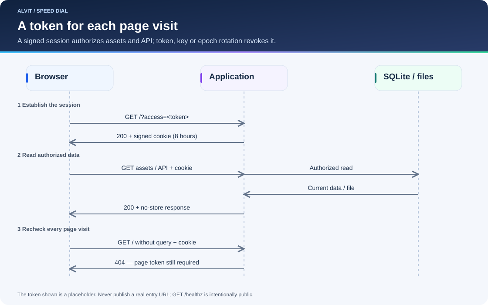
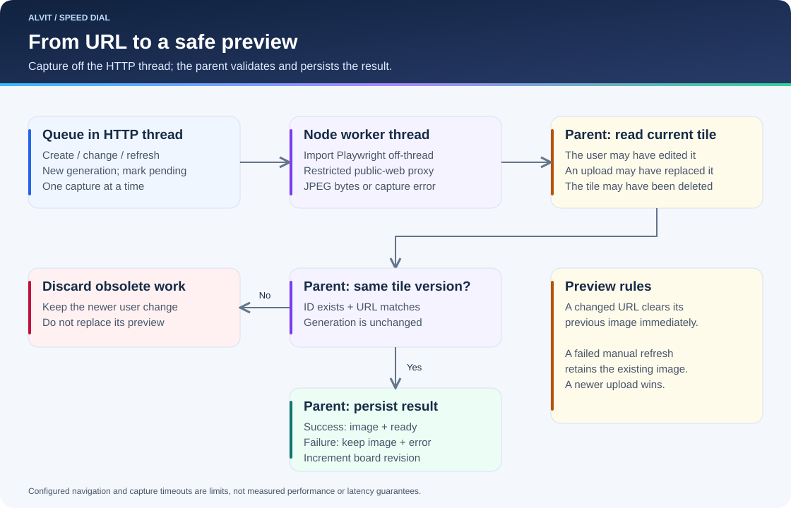

# Architecture

[Wiki home](Home.md) · [API](API.md) · [Operations](Operations.md)

This page describes the self-hosted implementation. The browser interface is plain JavaScript; `server.mjs` handles HTTP, sessions, persistence, revisions, and the screenshot queue. `screenshot.mjs` delegates capture to a Node worker thread running `screenshot-worker.mjs`; `safe-proxy.mjs` restricts capture network access.

This page describes the self-hosted edition. The public [Speedial app](https://speedial.alvit.here.now/) uses browser-local storage and no shared HTTP API or automatic screenshot service. See [local architecture, privacy and backup transfers](../docs/local-speedial.md).

## Access and credentials

The operator configures required `ACCESS_TOKEN_FILE` and `SESSION_KEY_FILE` paths. The token is trimmed URL-safe text of at least 32 characters, preferably generated from random bytes. The key has at least 32 raw bytes. They are read at startup and must remain outside source, images, and public documentation.

Every root/index page visit requires the correct `access` query value. The page issues an eight-hour signed HttpOnly, SameSite=Strict cookie; HTTPS `PUBLIC_ORIGIN` enables Secure. Assets, images, API reads, and edits require that cookie. `/healthz` is the deliberate unauthenticated exception.

The signing domain includes an epoch derived from the access-token digest and optional `AUTH_EPOCH`. A token, key, or epoch rotation invalidates older sessions after restart. Rotating only the signing key or epoch does not revoke the unchanged entry token. All holders of a valid token have shared read/write access; this is not per-user authorization.

## State and migration

SQLite stores a single JSON board and up to 100 pre-edit history snapshots. A board contains a revision, rows/columns, link-opening preference, and ordered tiles. Tiles contain identity, title, URL, image reference, capture state, error/code, and a generation marker. User edits save history and increment the revision; capture completion increments the revision without a new user-edit snapshot.

A new database starts empty unless an operator supplies `INITIAL_STATE_FILE`. Existing databases are never reseeded by this setting. Private seeds are external files, not source fixtures. Language remains in browser localStorage, separate from shared board state.

Generated and uploaded previews live under `DATA_DIR/images`. Optional migrated thumbnails live under `DATA_DIR/legacy-images` and continue to serve compatible legacy image URLs. Private thumbnail bytes are not copied into application source or image layers. Credential files are a separate external mount; the application no longer creates a default signing key inside data.

Image cleanup retains generated images referenced by current data or retained history. Offline migration must preserve both current and historical references. See the [cutover runbook](../deploy/README.md) for the reviewed migration utility and isolated verification.

## Screenshot lifecycle

Creating a tile, changing its URL, or refreshing assigns a new generation and queues work. The parent HTTP thread still owns one serial queue; startup requeues persisted pending work. Each capture gets a dedicated worker thread that imports Playwright, controls Chromium and the restricted proxy, and returns JPEG bytes or an error. Completion waits for browser/proxy cleanup and worker shutdown. The worker does not write the board, history, or persistent image files.

The parent checks the tile identity, URL, and generation before saving a result, exactly as before. Deleted tiles, replaced URLs, and newer uploads therefore cannot be overwritten by obsolete results. Moving Playwright initialization and capture off the HTTP event loop addresses a reproduced stall: slow synchronous driver initialization blocked API requests and could cause keep-alive connections to reset. It does not add parallel captures or another persistence writer.

Changing a URL clears its prior preview; a failed manual refresh retains the current image. Chromium uses a fresh context without personal cookies, a 1366 × 860 viewport, and `en-US` capture locale. Captures produce JPEG bytes. Configured navigation/capture timeouts are limits, not end-to-end latency guarantees.

## Process and network controls

The proxy resolves and pins approved public IPv4 addresses for each connection. HTTP port 80 and HTTPS port 443 are supported; private, loopback, link-local, special-use, and metadata destinations are blocked. Redirects and subresources remain subject to the same boundary. Chromium disables QUIC and non-proxied WebRTC UDP and uses no persistent profile.

The pod adds non-root execution, dropped capabilities, no privilege escalation, a read-only root filesystem, no service-account token, and an egress NetworkPolicy. Chromium uses `--no-sandbox`; its own sandbox is not an additional defense. NetworkPolicy protection depends on enforcement by the cluster network.

## Concurrency and deployment

One process owns one SQLite volume. A single-replica `Recreate` deployment avoids simultaneous writers but can interrupt service during replacement. Horizontal scaling and automatic failover are not implemented.

Browser polling avoids replacing newer mutation results with stale reads. Forms retain the revision from when they opened; a conflict refreshes remote data while preserving unsaved user input and requires an explicit retry. A language-only save does not touch shared state.

The reference manifests deliberately use generic infrastructure values. Operators provide their own storage placement, verified image, secret mounts, public origin, ingress/tunnel selectors, and existing Terraform backend identity. None of those environment-specific values belong in a public source example.
