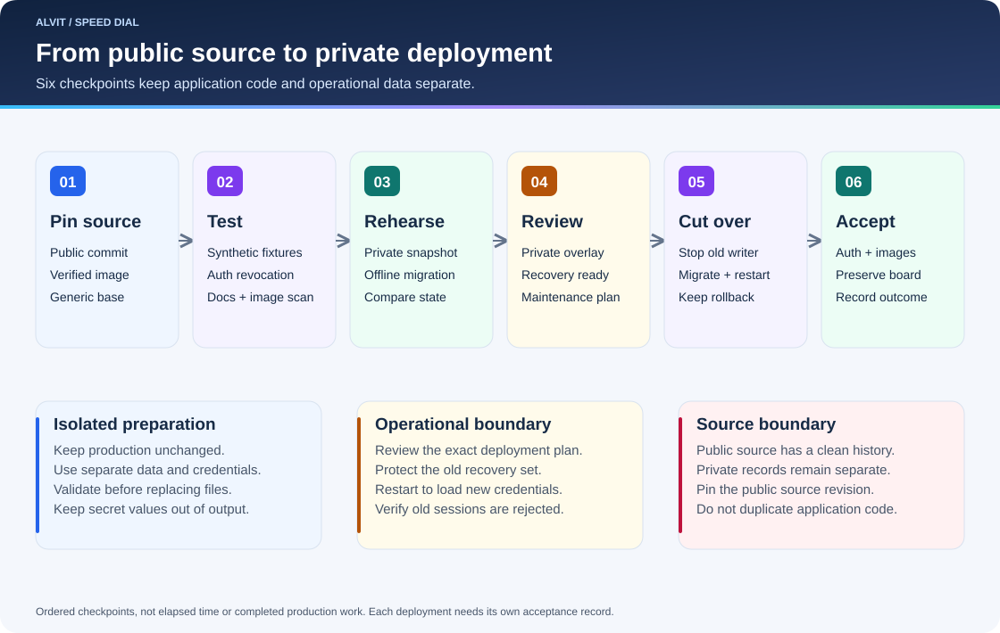
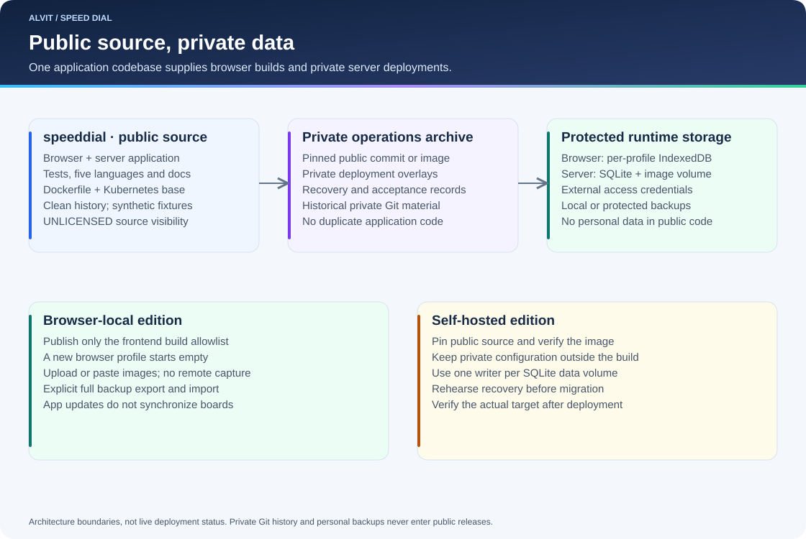

# Broncode, implementatie en verificatie

<!-- language-navigation:start -->

<a href="Process-and-Results.md" lang="en" dir="ltr">English</a>
<a href="Process-and-Results.ar.md" lang="ar" dir="rtl">العربية</a>
<a href="Process-and-Results.bn.md" lang="bn" dir="ltr">বাংলা</a>
<a href="Process-and-Results.cs.md" lang="cs" dir="ltr">Čeština</a>
<a href="Process-and-Results.de.md" lang="de" dir="ltr">Deutsch</a>
<a href="Process-and-Results.es.md" lang="es" dir="ltr">Español</a>
<a href="Process-and-Results.fa.md" lang="fa" dir="rtl">فارسی</a>
<a href="Process-and-Results.fr.md" lang="fr" dir="ltr">Français</a>
<a href="Process-and-Results.he.md" lang="he" dir="rtl">עברית</a>
<a href="Process-and-Results.hi.md" lang="hi" dir="ltr">हिन्दी</a>
<a href="Process-and-Results.id.md" lang="id" dir="ltr">Bahasa Indonesia</a>
<a href="Process-and-Results.it.md" lang="it" dir="ltr">Italiano</a>
<a href="Process-and-Results.ja.md" lang="ja" dir="ltr">日本語</a>
<a href="Process-and-Results.ko.md" lang="ko" dir="ltr">한국어</a>
<a href="Process-and-Results.nl.md" lang="nl" dir="ltr">Nederlands</a>
<a href="Process-and-Results.pl.md" lang="pl" dir="ltr">Polski</a>
<a href="Process-and-Results.pt.md" lang="pt" dir="ltr">Português</a>
<a href="Process-and-Results.ru.md" lang="ru" dir="ltr">Русский</a>
<a href="Process-and-Results.th.md" lang="th" dir="ltr">ไทย</a>
<a href="Process-and-Results.tr.md" lang="tr" dir="ltr">Türkçe</a>
<a href="Process-and-Results.uk.md" lang="uk" dir="ltr">Українська</a>
<a href="Process-and-Results.vi.md" lang="vi" dir="ltr">Tiếng Việt</a>
<a href="Process-and-Results.zh-Hans.md" lang="zh-Hans" dir="ltr">简体中文</a>
<a href="Process-and-Results.zh-Hant.md" lang="zh-Hant" dir="ltr">繁體中文</a>

<!-- language-navigation:end -->

[Wiki-startpagina](Home.md)

De openbare repository `speeddial` bevat beide app-edities, tests, algemene implementatievoorbeelden en documentatie. Hij begint met een nieuwe Git-geschiedenis en synthetische testgegevens. Privé beheerarchieven bewaren historisch materiaal en herstelgegevens en gebruiken een vastgelegde openbare bronrevisie of onveranderlijk image zonder applicatiecode te dupliceren.

De [browserlokale app](https://speeddial.alvit.here.now/) geeft iedere bezoeker een leeg bord. Publicatie van code kopieert geen persoonlijke links of schermafbeeldingen naar een andere browser. De [back-upscripts](../docs/browser-backups.nl.md) begeleiden een bewuste overdracht met een reddingskopie van het doel en een exacte inhoudsvergelijking na herstel.

## Implementatieproces

Node.js, Docker en k3s blijven ondersteund voor de servereditie. Leg de openbare revisie vast, bouw of selecteer een geverifieerd onveranderlijk image en pas privéconfiguratie buiten deze repository toe. Houd toegangsgegevens en het blijvende datavolume gescheiden van het app-image. Gebruik bij migratie de [omschakel- en terugdraaigids](../deploy/README.md).

## Grenzen van repository en gegevens

Openbare broncode bevat geen persoonlijk beginbord. Lokale browserback-ups blijven in het door Git genegeerde `backups/`; serverherstelsets bevatten SQLite, verwezen afbeeldingsbestanden en apart beschermde toegangsgegevens. De formaten dienen verschillende edities en zijn niet uitwisselbaar.

## Verificatie

Lokale en CI-controles valideren synthetische gegevens en de uitgevoerde scenario's. Beide edities behouden vijf talen, ingeklapte bediening, paarsgewijs wisselen, aanwijzervolgende voorvertoningen, rasterafmetingen en standaardnavigatie in hetzelfde venster.

Een servermigratieoefening vergelijkt IDs, volgorde, titels, URLs, instellingen, afbeeldingsverwijzingen en SQLite-integriteit. Rotatiecontroles verifiëren dat oude sessies na herstart mislukken. Werkelijke implementatieacceptatie controleert daarnaast bedoelde routering, toegangsgegevens, afbeeldingsbeschikbaarheid en gegevensbehoud in de doelomgeving.

Een geslaagde broncontrole bewijst niet dat implementatie of herstel heeft plaatsgevonden. Houd werkelijke implementatiebewijzen en persoonlijke inventarissen privé. Diagrammen beschrijven architectuur en proces, geen garanties voor prestaties, beschikbaarheid of hersteltijd. De openbare broncode blijft `UNLICENSED`.
