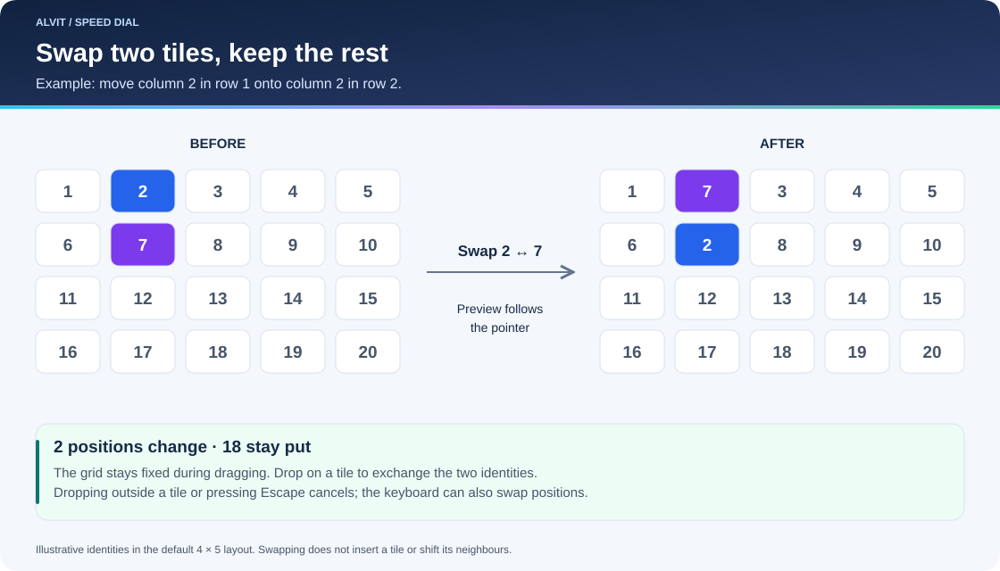

# User guide

[Wiki home](Home.md) · [Troubleshooting](Troubleshooting.md)

## Public Speed Dial: local boards

Open [speeddial.alvit.here.now](https://speeddial.alvit.here.now/) and keep this primary address in your bookmarks. No password or access query is needed. A new visitor or browser profile sees an empty board, not anyone else’s links or screenshots.

Expand the upper-right arrow to reveal controls. Add a link and, if desired, choose an image file or paste a copied screenshot in the editor before saving. Automatic screenshots are not available in this edition. Tiles still swap one-to-one, the dragged preview follows the pointer, and Settings provides rows, columns, link-opening behavior and five languages.

**Export backup** saves the complete board as private, unencrypted JSON, including image bytes and language. **Import backup** previews the file before you confirm replacement of the destination board. Export any destination data you need first. Verify the restored board after reload and retain a protected copy. Import is a one-time transfer; it does not synchronize devices.

Browser profiles and different site addresses have separate storage even when the app looks identical. Always return to the same primary address, or deliberately transfer the board with a full backup. Clearing browser data can remove the board. See the [complete local guide](../docs/local-speedial.md) for privacy, persistence and transfer details.

The remaining sections describe the self-hosted shared-board edition.

## Open and navigate

Use the complete entry link supplied privately by the operator. Its form is `https://bookmarks.example.test/?access=<token>`; the angle-bracketed text is only a placeholder. The correct token is required on every page navigation. A bare URL, missing token, or incorrect value returns 404, even if a cookie already exists.

Everyone holding the link can edit the shared board. There is no additional editor password. Do not share the link beyond the intended audience. If an optional legacy redirect is configured, it preserves the query supplied by the caller; it must never inject a token.

The header is collapsed when the page opens. Select the arrow at the upper right to reveal Settings, Export, and Add site. Tile names remain available to assistive technology and the editor without taking space under every preview.

Select a tile to open its site. **Settings → Open links in** offers the same window (default) or a new window/tab. Browser preferences decide whether the latter becomes a tab or window. This preference applies to the shared board on other devices as well.

## Add, edit, and delete

1. Expand the header and choose **Add site**.
2. Enter the address and optionally a name. The UI accepts an address without `https://`; API clients must send an absolute HTTP(S) URL without embedded credentials.
3. Save. A placeholder appears while the server captures a screenshot.
4. Use the tile's pencil to change its name or URL, refresh its screenshot, upload a preview, or delete it. Deletion requires confirmation.

Changing a URL clears the previous site's screenshot immediately. Renaming a site preserves its current preview. A failed manual refresh preserves the existing preview, so a temporary capture failure does not erase it.

The board accepts up to 500 bookmarks. Names are metadata and accessible labels; they do not become persistent tile captions.

## Swap positions

Drag a thumbnail onto another thumbnail. A copy follows the pointer; the target is highlighted. On release, the source and target exchange positions. The tiles in between keep their exact positions. Dropping outside another tile, pressing Escape, or losing window focus cancels the move.

On a touch screen, use the tile's grip. For keyboard control, Tab to the move grip, then use Left/Right for the adjacent position or Up/Down for one configured row. Home swaps with the first bookmark; End swaps with the last. The application moves to the affected page when necessary. Use the previous/next page controls to browse; pointer dragging does not provide an automatic page-edge transfer.

## Set the grid and language

In **Settings**, choose 1–12 rows and 1–12 columns. Capacity is their product; for example, 4 rows × 5 columns shows 20 sites per page. Extra sites remain on later pages. Changing the grid never deletes or reorders bookmarks. Columns stay fixed on narrow displays; scroll horizontally when needed.

The language selector offers English, Русский, Deutsch, Français, and Español. English is the default. Language is stored in this browser, while rows, columns, and link-opening behavior are saved on the server for the shared board. Changing language does not translate your bookmark names or destination websites. See [localization](Localization.md) for storage and fallback details.

## Understand screenshots

Captures use a fresh server-side Chromium session at 1366 × 860, without your browser's login cookies. Only public IPv4 HTTP/HTTPS destinations on standard ports are captured. Private-network sites can be stored as bookmarks, but their preview must be uploaded. Sign-in screens, consent dialogs, bot challenges, and inaccessible sites can prevent a useful capture.

Upload PNG, JPEG, WebP, or GIF images up to 5 MiB through the editor. Optional migrated previews are retained until you explicitly replace their URL or refresh/upload a preview. New installations start with an empty board unless the operator provides external initial state. Captures run one at a time; changes appear after the board polls the server.

## Export and concurrent changes

**Export** downloads the board as JSON, including bookmark metadata and image paths. It is not a complete backup, because the image files are not embedded, and there is no import button or import API. Ask an operator to follow the [backup runbook](Operations.md#backup-and-restore) for full recovery.

Other browsers can edit the same board. If a change conflicts with a newer revision, the UI reloads the latest board, preserves your pending form edits, and asks you to save again after reviewing the conflict. This protects another person's work from being silently overwritten.
